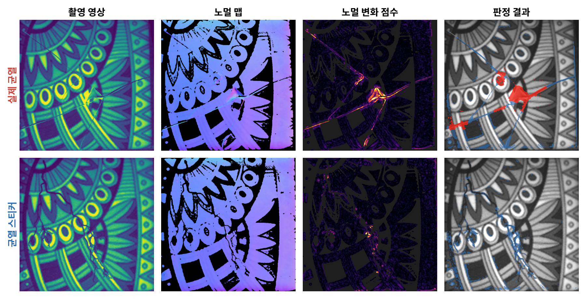
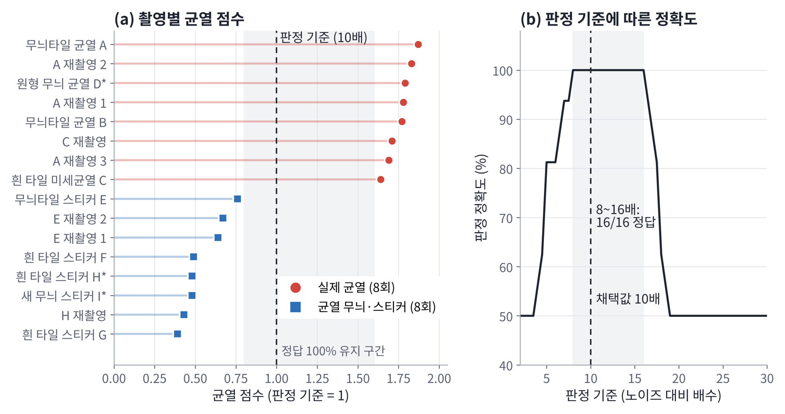
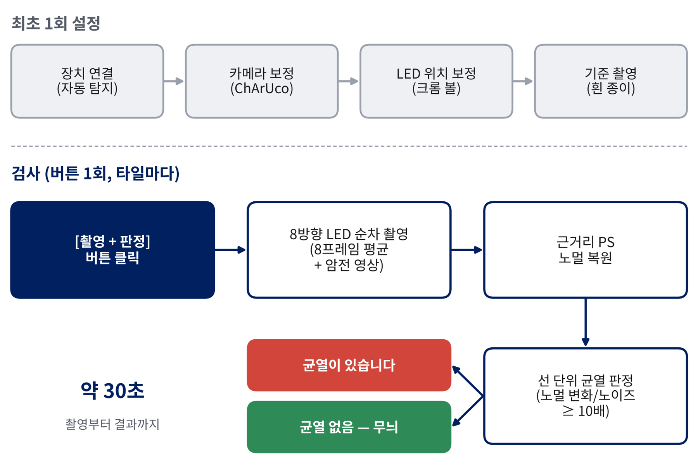

# PS Crack Inspector

**포토메트릭 스테레오 기반 타일 균열 판별 시스템**
Photometric Stereo-based Crack Discrimination System for Patterned Tiles

8방향 LED로 타일을 촬영해 표면 방향(노멀)을 복원하고, **실제 균열**과 **균열처럼 보이는 무늬·스티커**를 구분하는 검사 프로그램입니다.
홍익대학교 전자전기융합공학과 2026 졸업작품입니다.



---

## 원리

무늬 타일에서는 실제 균열과 균열 모양의 인쇄 무늬·스티커가 영상에서 똑같이 어두운 선으로 보입니다. 그래서 밝기만으로는 둘을 구분할 수 없습니다.

| | 실제 균열 | 무늬·스티커 |
|---|---|---|
| 영상 밝기 | 어두운 선 | 어두운 선 |
| 표면 방향(노멀) | 깨진 면을 따라 **꺾임** | 평평한 면이라 **변화 없음** |

이 프로그램은 다음 순서로 판정합니다.

1. **근거리 포토메트릭 스테레오**: 카메라 내부 파라미터(ChArUco)와 LED 3차원 위치(크롬 볼)로 픽셀마다 실제 빛 방향을 계산합니다. 흰 종이 기준 영상으로 LED 밝기 차이를 보정한 뒤 `I_k = ρ (n · l_k)`를 풀어 노멀을 구합니다.
2. **노멀 변화 점수**: 주변 평균 노멀과의 각도 차이를 같은 밝기에서의 노이즈 수준으로 나눕니다.
3. **선 단위 판정**: 후보 선의 중심선을 따라 반경 40 px 안의 점수 중앙값이 **10배 이상**이고, 길이가 **50 px(약 7.5 mm) 이상**이면 균열로 판정합니다.

## 결과

타일 9종을 16회 촬영해 **16회 모두 정답**이었습니다.

| 구분 | 샘플 | 촬영 | 정답 |
|---|---|---|---|
| 실제 균열 | 4종 | 8회 | 8 / 8 |
| 균열 무늬·스티커 | 5종 | 8회 | 8 / 8 |

- 실제 균열의 점수는 판정 기준의 1.64배 이상, 스티커는 0.76배 이하로 서로 겹치지 않습니다.
- 판정 기준을 8~16배 사이 어디로 바꿔도 16회 모두 정답을 유지합니다.
- 판정 시간은 원본 해상도(1280×800)에서 장당 약 4초, 촬영부터 결과까지 약 30초입니다.



## 검사 흐름



## 하드웨어

| 항목 | 내용 |
|---|---|
| 조명 | 반구형 돔에 백색 LED 8개 배치, Arduino로 제어 (115200 baud) |
| 카메라 | USB 카메라, 1280×800, YUY2 무압축, 픽셀당 약 0.15 mm |
| 캘리브레이션 도구 | ChArUco 보드(`charuco_11x7_6mm_A4.pdf`, 100% 크기로 인쇄), 지름 30 mm 크롬 볼 |

Arduino 시리얼 명령은 다음과 같습니다.

| 명령 | 동작 | 응답 |
|---|---|---|
| `0` | 전체 끄기 | `OFF` |
| `1`~`8` | 해당 LED 하나 켜기 | `ON` |
| `9` | 전체 켜기 | |
| (리셋 시) | | `READY` |

## 설치 (Python으로 실행할 때)

Windows 10/11, Python 3.11에서 확인했습니다.

```bash
pip install -r requirements.txt
python ps_app.py
```

`run_inspector.bat`를 더블클릭해도 실행됩니다.

## 사용 방법

화면 왼쪽의 단계를 위에서부터 차례로 진행합니다. 자세한 내용은 [`사용설명서.txt`](사용설명서.txt)에 있습니다.

| 단계 | 내용 | 결과 파일 |
|---|---|---|
| 0. 장치 연결 | 아두이노와 카메라를 자동으로 찾아 연결 | `ps_config.json` |
| 1. 카메라 캘리브레이션 | ChArUco 보드를 여러 각도로 15~25장 + 바닥에 놓고 1장 | `camera_intrinsics.npz` |
| 2. LED 위치 캘리브레이션 | 크롬 볼을 4~5곳에 놓고 촬영 | `led_positions.npz` |
| 3. 기준 촬영 | 흰 종이를 깔고 촬영 | `ps_ref/` |
| 4. 균열 검사 | 타일을 놓고 **[촬영 + 판정]** | `ps_out/<이름>/fast/verdict.png` |

0~3단계는 처음 설치할 때 한 번만 하면 됩니다. 결과 파일은 장치마다 달라서 이 저장소에는 포함하지 않았습니다.

## 실행 파일(exe) 만들기

```bash
pip install pyinstaller
python build_release.py
```

| 결과물 | 용도 |
|---|---|
| `dist/PS_Inspector/PS_Inspector.exe` | 이 PC용. 현재 캘리브레이션이 함께 복사됨 |
| `dist/PS_Inspector_release.zip` | 배포용. 프로그램, 사용설명서, ChArUco PDF만 포함 |

exe는 빌드할 때의 코드를 묶어 두므로, `.py`를 수정하면 다시 빌드해야 합니다. 캘리브레이션과 검사 결과는 exe 옆 폴더에 저장됩니다.

## 파일 구성

| 파일 | 역할 |
|---|---|
| `ps_app.py` | 데스크톱 앱(Tkinter). exe의 진입점 |
| `ps_run.py` | 카메라·아두이노 제어, 촬영, 경로 설정 |
| `camtest_and_solver.py` | 노멀 복원과 선 단위 균열 판정. 카메라 진단(`fmt`, `lin`)과 정답 표시 도구(`label`) 포함 |
| `charuco_calib.py` | 카메라 캘리브레이션 (ChArUco 11×7, 칸 6 mm, 마커 4.5 mm, DICT_4X4_50) |
| `led_calib.py` | 크롬 볼로 LED 3차원 위치 추정 |
| `build_release.py` | exe 빌드와 배포용 zip 생성 |
| `run_inspector.bat` | Python으로 앱 실행 |
| `charuco_11x7_6mm_A4.pdf` | 캘리브레이션 보드 (A4, 100% 크기로 인쇄) |
| `firmware/` | Arduino LED 제어 코드 |

## 한계

- 조각이 전혀 어긋나지 않은 아주 가는 균열은 일부 구간만 검출되거나 무늬로 판정될 수 있습니다.
- 진한 무늬 위의 픽셀은 신호가 약해 판정 불가 영역으로 남습니다.
- 표시되는 균열 길이는 판정된 구간만의 길이라 실제보다 짧을 수 있습니다.
- 방 조명이 켜져 있으면 정확도가 떨어집니다.

## 참고 문헌

1. R. J. Woodham, "Photometric method for determining surface orientation from multiple images," *Optical Engineering*, 19(1), 139–144, 1980.
2. Z. Zhang, "A flexible new technique for camera calibration," *IEEE TPAMI*, 22(11), 1330–1334, 2000.
3. S. Garrido-Jurado et al., "Automatic generation and detection of highly reliable fiducial markers under occlusion," *Pattern Recognition*, 47(6), 2280–2292, 2014.
4. 김영민, 김선욱, 조한진, "비동기식 포토메트릭 스테레오 시스템의 고속 영상 획득 방법," OPC 2026.

## 만든 사람

- 김영민 (홍익대학교 전자전기융합공학과)
- 지도교수: 김세중

본 작품은 2026년 교육부 및 세종시의 재원으로 세종RISE센터의 지원을 받아 수행된 지역혁신중심 대학지원체계(RISE)의 결과입니다. (2026-RISE-08-002)
